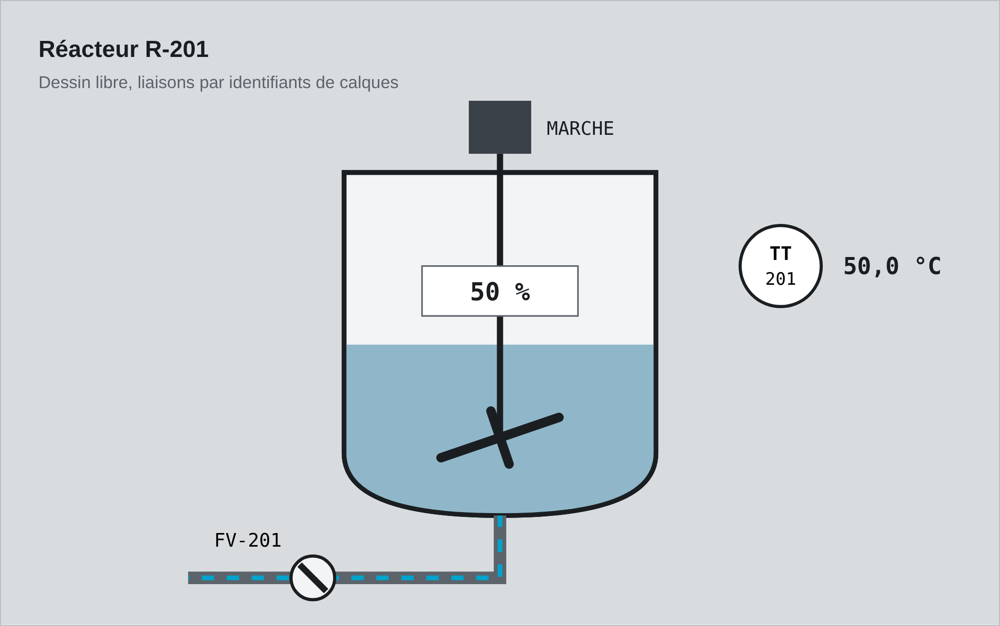

# hmi-synoptic (édition gratuite)

Synoptiques animés pour le web. Dessinez votre installation dans Inkscape, Figma, Illustrator ou draw.io, nommez quelques calques (`LT101--level`, `P101--spin`), et `<hmi-synoptic>` anime le dessin avec vos mesures : niveaux, rotations, flux, états, valeurs et alarmes. Aucun code par écran.



* Web Component sans dépendance, environ 10 Ko gzip. HTML, Angular, React, Vue, Svelte.
* 13 liaisons : `level`, `spin`, `angle`, `move`, `flow`, `text`, `state`, `visible`, `alarm`, `fill`, `stroke`, `blink`, `select`.
* Alarmes ISA-18.2 (LL/L/H/HH, hystérésis, priorités 1 à 4, acquittement), qualité de donnée, thème clair et sombre.
* SVG importés nettoyés (scripts, gestionnaires `on*`, liens externes retirés). Aucune image calculée au repos.
* Adaptateurs WebSocket, Server-Sent Events et interrogation périodique.

Licence MIT : usage libre, y compris commercial.

## Essayer

```bash
python3 -m http.server 8000      # ou : npx serve .
# puis ouvrez http://localhost:8000/exemple/
```

## Utiliser

```html
<hmi-synoptic id="synoptique" src="installation.svg"></hmi-synoptic>
<script type="module">
  import './dist/hmi-synoptic.js';
  const s = document.getElementById('synoptique');
  s.config = { LT101: { unit: '%', h: 80, hh: 90 }, P101: { label: 'Pompe 1' } };
  s.update({ LT101: 62, P101: 'running', FT101: 140 });   // à chaque nouvelle mesure
</script>
```

Dans votre SVG, nommez les éléments à animer `VARIABLE--type` (identifiant ou nom de calque) ou ajoutez des attributs `data-hmi-level="LT101"`, `data-hmi-spin="P101"`… L'exemple `exemple/dessin-inkscape.svg` montre les deux.

| Liaison | Effet |
|---|---|
| `level` | remplissage vertical (niveau de cuve) |
| `spin` | rotation continue, avec inertie (pompe, ventilateur) |
| `angle` | rotation à l'angle (vanne papillon, aiguille) |
| `move` | translation (vérin, chariot) |
| `flow` | tirets animés dans une tuyauterie, vitesse selon le débit |
| `text` | valeur formatée (décimales, unité, marque de qualité) |
| `state` | état discret traduit par une table (`0:ARRÊT,1:MARCHE`) |
| `visible`, `blink` | affichage et clignotement sur condition |
| `alarm` | indicateur ISA forme + couleur + priorité |
| `fill`, `stroke` | couleur selon la valeur |
| `select` | élément cliquable, événement `hmi-select` |

API : `set(tag, valeur, qualité?)`, `update({...})`, `setQuality()`, `ack(tag?)`, propriété `alarms`, événements `hmi-load`, `hmi-error`, `hmi-select`, `hmi-alarm`. Les types TypeScript sont dans `dist/types`.

## Édition complète

L'édition complète ajoute la bibliothèque de symboles animés générés par code (cuves, pompes, vannes, instruments ISA, échangeur, filtre, chaudière…), deux synoptiques prêts et simulés (station d'eau potable, chaufferie collective) avec fiches, alarmes, journal et scénarios, le catalogue des symboles, l'atelier « déposez votre SVG », la documentation complète (intégrations Angular, React, Vue, MQTT, OPC UA), les tests et le support par e-mail. Elle est vendue par l'auteur sur sa page de vente, indiquée dans la description de ce dépôt.

## Avertissement

hmi-synoptic est une couche d'affichage. Il ne remplace ni les automatismes ni les sécurités du procédé. Les données de l'exemple sont fictives.
